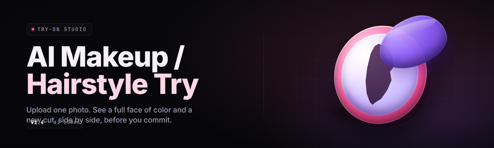

  
  
  

  

  
  
  

---

Local AI makeup and hairstyle try-on studio for creators and shoppers — preview looks on your own face without per-render subscriptions.

## Overview

Local AI makeup and hairstyle try-on studio for creators and shoppers — preview looks on your own face without per-render subscriptions.

  

## License

[MIT License](LICENSE)

  

